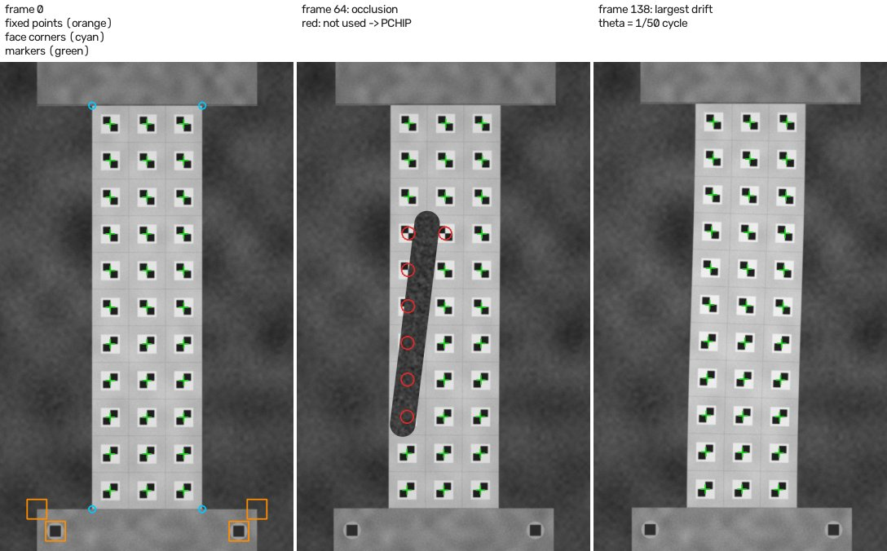
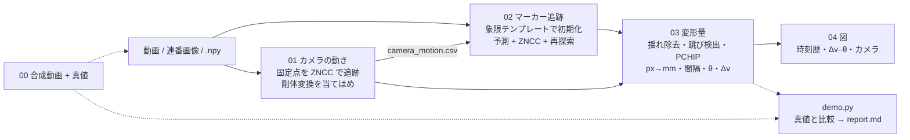
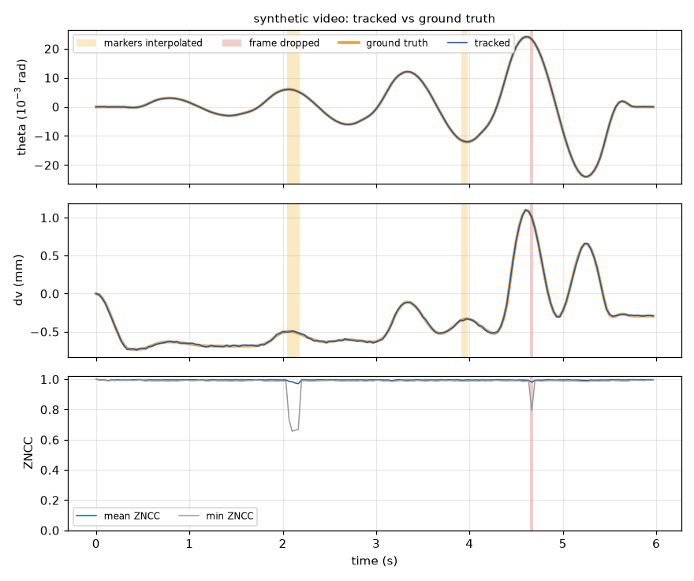
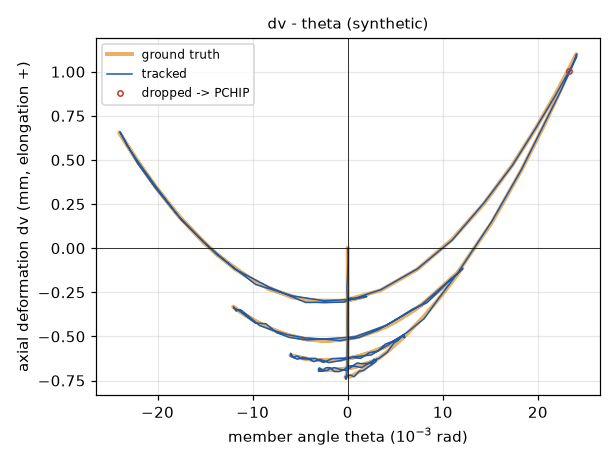
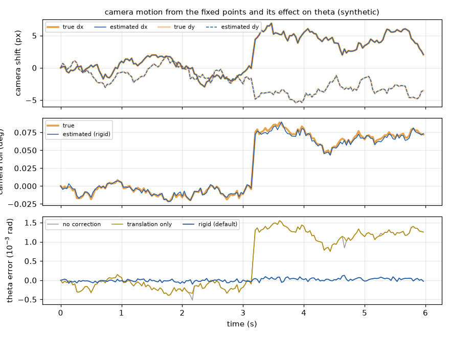

# column-marker-tracking

[](https://github.com/zhouliangtingq2-dev/column-marker-tracking/actions/workflows/demo.yml)

**RC 柱の載荷実験の動画から、動かない部分（スタブの角など）を基準にカメラの揺れを取り除き、柱面の 3×11 個のマーカーを追跡して部材角 θ と軸方向変形 Δv を求めるパイプライン**

[English README](README_en.md)

- **課題**：柱の一面（300×1100 mm）に 3 列×11 行＝33 個のチェッカー型マーカーを貼り、約 3200×4800 px・30 fps の動画から変形を読み取りたい。ところが三脚のわずかな揺れ（並進と回転）がそのまま「変位」に混ざり、人や器具の映り込み・反射で値が跳ぶフレームも出る。
- **解決**：スタブなど動かない構造の角を固定点として毎フレームのカメラの動きを推定し、マーカー座標から差し引く。マーカーは前フレームからの予測位置の周りで ZNCC テンプレートマッチング（サブピクセル）により追跡し、相関の低い点・値の跳び・使えないフレームを自動で除いて PCHIP で補間する。柱面四隅の既知寸法で px→mm に換算し、マーカー列への直線当てはめで θ を、上下端のマーカー群の間隔で Δv を求める。
- **結果**：元の MATLAB 実装を研究室の RC 柱実験の動画に使い（例：一定軸力の試験の動画 853 フレームのうち、値が跳んだ 21 フレームを除外）、求めた変形は第一著者の学会論文（コンクリート工学年次大会 2026）で使った。真値の分かる合成動画（180 フレーム、カメラの揺れ・遮蔽・反射入り）では、θ の RMS 誤差 4.2×10⁻⁵ rad、Δv の RMS 誤差 0.008 mm。

研究室の RC 柱の載荷実験で必要になり、実際に使った処理（研究室内の MATLAB 実装）を Python で書き直したものです。このリポジトリには**コードと、真値つきの合成動画を作るスクリプトだけ**を含めています。実験の動画・画像・計測値は研究室のデータのため公開していません。同じ研究室の実験で使ったもう一つのツール：[crack-label-loop](https://github.com/zhouliangtingq2-dev/crack-label-loop)（RC 壁のひび割れのラベリング）。



*合成デモ動画（600×1000 px）：左 1 フレーム目（橙＝カメラの動きを測る固定点、水色＝px→mm の換算に使う柱面の四隅、緑＝追跡したマーカー）｜中 遮蔽が入ったフレーム（赤＝このフレームでは使わず補間したマーカー）｜右 変形が最大のフレーム。*

## 処理の流れ



| スクリプト | 役割 |
|---|---|
| `scripts/00_make_synthetic.py` | 合成デモ動画（PNG 連番）、真値の CSV、そのまま使える設定ファイルを作る。実験データは不要 |
| `scripts/01_camera_motion.py` | 固定点（スタブの角・ボルトなど）を 1 フレーム目のテンプレートで追跡し、毎フレームのカメラの動き（並進／剛体／相似変換）を `camera_motion.csv` に出す |
| `scripts/02_track_markers.py` | 33 個のマーカーを初期化して追跡し、座標・ZNCC・状態（正常／再探索で回復／見失い／フレームごと除外）を CSV に出す |
| `scripts/03_deformation.py` | 揺れの除去、跳びの検出、PCHIP 補間、px→mm、隣接マーカーの間隔・θ・Δv |
| `scripts/04_plot.py` | 時刻歴（θ・Δv・ZNCC と除外フレーム）、Δv–θ、カメラの動き、中央列の変位の図 |
| `scripts/run_pipeline.py` | 01〜04 をまとめて実行 |
| `scripts/pick_points.py` | （任意）1 フレーム目で固定点・四隅・角のマーカーをクリックして設定ファイルに書く（OpenCV のウィンドウ）。デモと CI では使わない |
| `scripts/demo.py` | 00〜04 を順に実行し、カメラの補正なし・並進のみ・相似変換の場合も計算して真値と比べ、`report.md` を出す（CI でもこれを実行） |
| `cmtrack/` | 処理の本体（`camera.py`・`markers.py`・`zncc.py`・`clean.py`・`deform.py` など） |
| `tests/` | ZNCC のサブピクセル位置、カメラの動きの推定、px→mm、跳びの検出と補間、θ・Δv の単体テスト（`pytest -q`） |

## 処理の中身

1. **入力**（`cmtrack/frames.py`）：動画ファイル、連番画像のフォルダ、`.npy` のいずれか。グレースケールにして σ = 1 px のガウスぼかしをかける（テンプレートも同じ処理をした 1 フレーム目から切り出す）。横向きに撮った動画は `rotate` で回す。
2. **カメラの動き**（`01`、`camera.py`）：スタブの角やボルトなど動かない部分の点を数か所指定しておき、1 フレーム目から切り出したテンプレート（既定 41 px）を各フレームで ZNCC により探す。探索の中心は前フレームの推定から予測し、見つからなければ 3 倍の窓で探し直す。見つかった点から「1 フレーム目 → k フレーム目」の変換 A_k を最小二乗で求める（既定は剛体＝回転＋並進。点が 1 つなら並進、カメラが前後に動くおそれがあれば相似変換）。残差が 1 px を超える点はそのフレームだけ外す。
3. **マーカーの初期化**（`02`、`markers.py`）：四隅のマーカーをおおよそ指定すると、残りは双一次補間で位置を出す（全点を与えてもよい）。各点の周りで、理想的な 2×2 チェッカー（行によって「右上・左下が黒」か「左上・右下が黒」）のテンプレートと ZNCC を取り、黒白の交点＝中心に合わせる。相関が 0.5 未満の点があれば止める（パターンの行の指定違いもここで分かる）。
4. **追跡**：各マーカーの位置を、揺れを除いた座標で「前フレームの位置＋0.7×速度」と予測し、A_k で現フレームの座標に移した位置を中心に探す。探索窓は前フレームの相関が高いほど狭くする（既定 ±12 px の 0.6〜1.5 倍）。ZNCC の最大値の周り 3×3 に 2 次曲面を当てはめてサブピクセル位置を出し、相関 0.7 以上かつ予測から 10 px 以内なら採用する。だめなら 1 フレーム目のテンプレートで 3 倍の窓を探し直し（再探索）、①相関 0.5 以上、②その位置に正しい向きのチェッカーがある、③縦の隣のマーカーとの位置関係が 1 フレーム目から 20 % 以上ずれていない、の 3 つを満たすときだけ採用する。それでもだめならそのフレームでは「見失い」とする。
5. **フレーム単位の判定**：見失いが 40 % を超える、採用した点の相関の平均が 0.5 未満、基準行（最下段）をすべて見失った、全体の動き（揺れ除去後の移動量の中央値）が直前 15 フレームの平均の 5 倍かつ 5 px を超えて跳んだ、のいずれかならフレームごと除外する。
6. **揺れの除去と跳びの検出**（`03`、`clean.py`）：追跡した座標を A_k の逆変換で 1 フレーム目のカメラの座標に戻す。相関 0.85 未満の値は使わない。各マーカーの x・y の時系列について、移動中央値（7 フレーム、窓の中の傾きを補正したもの）からのずれが「6×ロバスト標準偏差」と 1.5 px の大きい方を超えた値を跳びとして除き、同じフレームで 4 点以上跳んでいればそのフレームを除外する。
7. **補間と px→mm**：除いた値・見失った値・除外したフレームは PCHIP（形を保つ 3 次補間、両端は最寄りの値）で埋める。柱面の四隅（300×1100 mm）から最小二乗のアフィン変換で mm に換算する（既定。四隅の幅・高さから x・y 別々の倍率を出す方法、射影変換、マーカーの既知の間隔から出す方法も選べる）。
8. **変形量**（`deform.py`）：
   - 隣接マーカーの間隔の変化：横に隣り合う 22 組の X 方向、縦に隣り合う 30 組の Y 方向
   - 部材角 θ：中央列 11 点の座標 (Y, X) に最小二乗で直線を当てはめ、傾きの atan の 1 フレーム目からの変化（列ごと・3 列平均も出力）
   - 軸方向変形 Δv：中央列の上 2 点（第 10・11 行）の平均と下 2 点（第 1・2 行）の平均の鉛直距離の変化（伸びを正。設定で縮みを正にもできる）と、初期の標点距離で割った ε_v
   - θ と Δv の時系列にも同じ跳びの検出（5 フレーム、下限は θ 0.002 rad・Δv 0.2 mm）をかけ、跳んだフレームを除外して 7. からやり直す
9. **出力と図**（`04`）：`deformation.csv`（θ・Δv・ε_v・除外の有無と理由）、`markers_mm.csv`、`markers_filled.csv`（補間した値の印）、`displacement_mm.csv`（基準行に対する相対変位も）、`spacing_x_mm.csv`・`spacing_y_mm.csv`、`bad_frames.csv`、図（時刻歴、Δv–θ、カメラの動き、中央列の変位）。

## クイックスタート（合成動画で一通り）

```bash
python -m venv .venv && source .venv/bin/activate      # Windows: .venv\Scripts\activate
pip install -r requirements.txt
python scripts/demo.py --root demo_runs                 # CPU で約 1 分（うち合成動画の生成が約 20 秒）
pytest -q                                               # 単体テスト（任意）
```

Windows では `run_demo.bat`、Linux / macOS では `run_demo.sh` でも同じことができます。`demo_runs/report/report.md` に真値との比較と下の図ができます。

| 量 | RMS 誤差 | 最大誤差 | 真値の範囲 |
|---|---|---|---|
| 部材角 θ | 4.2×10⁻⁵ rad | 1.3×10⁻⁴ rad | −0.024〜+0.024 rad |
| 軸方向変形 Δv | 0.008 mm | 0.018 mm | −0.73〜+1.10 mm |
| マーカーの変位 | 0.037 mm | 0.60 mm（遮蔽された点） | − |

カメラの揺れの補正の効果（同じ追跡結果で、補正の方法だけを変えた比較）：

| カメラの補正 | θ の RMS 誤差 (rad) | Δv の RMS 誤差 (mm) | 変位の RMS 誤差 (mm) |
|---|---|---|---|
| なし | 8.5×10⁻⁴ | 0.012 | 6.1 |
| 並進のみ | 8.5×10⁻⁴ | 0.011 | 0.57 |
| **剛体（既定）** | **4.2×10⁻⁵** | **0.008** | **0.037** |
| 相似変換 | 4.2×10⁻⁵ | 0.029 | 0.042 |

わざと入れた異常のうち、遮蔽 4 フレーム・反射 2 フレーム・画像の帯状のずれ 1 フレームはすべて検出された（マーカー単位で補間 6 フレーム、フレームごと除外 1 フレーム）。三脚がぶつかったフレーム（ぶれあり）は揺れの補正で吸収され、異常のないフレームの誤検出は 0。

（合成動画：600×1000 px、30 fps、0.75 px/mm（1.33 mm/px）、マーカー 30 px、カメラの揺れは最大 7.9 px・0.09°、乱数シード 0。θ と Δv の真値は、真のマーカー位置に同じ定義（中央列の直線当てはめ、上下 2 行ずつの差）を当てはめた値。実装の確認用の数値で、実験の動画での精度を示すものではない。OpenCV などの版によってわずかに変わる。）



*合成動画の θ・Δv・ZNCC の時刻歴（橙＝真値、青＝追跡結果）。黄色はマーカーの一部を補間したフレーム、赤はフレームごと除外したフレーム。*



*Δv–θ 関係（合成動画）。サイクルごとに伸びが残るように真値を作っている。*



*上：固定点から推定したカメラの並進、中：回転、下：θ の誤差。並進だけを補正しても θ の誤差は減らない（カメラの回転がそのまま θ に乗る）。*

## 自分の動画で使う

```bash
# 1. configs/example.yaml をコピーし、動画のパス・柱面の寸法・マーカーの行数とパターン・テンプレートの大きさを直す
# 2. 1 フレーム目で点を指定する（座標を YAML に直接書いてもよい）
python scripts/pick_points.py --frames path/to/video.mp4 --what fixed   --out picked.yaml   # 動かない点（数か所、離して）
python scripts/pick_points.py --frames path/to/video.mp4 --what corners --out picked.yaml   # 柱面の四隅 LB, LT, RB, RT
python scripts/pick_points.py --frames path/to/video.mp4 --what markers --out picked.yaml   # 四隅のマーカー
# 3. 01 → 04 を実行
python scripts/run_pipeline.py --config my_test.yaml --config picked.yaml --out runs/test1
# 途中の結果は CSV なので、しきい値を変えて変形量だけ計算し直せる
python scripts/03_deformation.py --config my_test.yaml --config picked.yaml --out runs/test1
python scripts/04_plot.py        --config my_test.yaml --config picked.yaml --out runs/test1
```

設定の全項目と既定値は `configs/example.yaml` と `cmtrack/config.py` にあります。`--config` は複数指定でき、後のファイルが前のファイルを上書きします。動作確認：Python 3.11 / 3.13、NumPy 2.x、OpenCV 5.0（`requirements.txt`）。

## 設計上の判断（なぜこうしたか）

- **画像は動かさず、座標だけを補正する**：元の手順では、揺れを除いた動画を書き出してから追跡していた。ここではカメラの変換 A_k を先に求め、マーカーは元の画像のまま追跡して座標を A_k の逆変換で戻す。画像を補間し直さないのでぼけず、動画を書き出す時間と容量も要らない。A_k は探索窓の予測にも使うので、三脚がぶつかって数 px 跳んでもマーカーを見失わない（合成デモの「三脚がぶつかったフレーム」）。
- **固定点のテンプレートは更新しない**：揺れを測る基準そのものなので、1 フレーム目のテンプレートを最後まで使う（更新すると少しずつずれていく）。マーカーのテンプレートも既定では更新しない。合成デモでは更新ありとなしの差はほとんどなかったので、ずれが起きない方を既定にした（表面の見た目が徐々に変わる動画のために、相関 0.9 以上のときだけ少しずつ更新する `ema` も残している）。
- **カメラの動きは剛体（回転＋並進）を既定にする**：並進だけでは、わずかな回転（合成デモで最大 0.09°）がそのまま θ の誤差になる（θ の RMS 誤差 8.5×10⁻⁴ rad → 剛体で 4.2×10⁻⁵ rad）。縮尺まで推定する相似変換は、固定点がスタブの上に横並びで基線が短いため縮尺の推定がぶれ、それが標点距離に掛かって Δv の誤差が 0.008 mm から 0.029 mm に増えた。カメラが前後に動くおそれがある場合だけ相似変換を選ぶ。
- **サブピクセル位置は 3×3 の 2 次曲面（xy 項を含む）の頂点で求める**：x と y に別々に放物線を当てる方法は、チェッカーのように相関の山が縦横に対称なら十分だが、固定点の周りの模様のように山が斜めに伸びると偏る。斑点模様のテスト（`tests/test_matching.py`）では x 方向だけ 0.5 px ずらしたのに y が最大 0.19 px ずれ、xy 項を含む 2 次曲面にすると誤差は 0.01 px 以下になった。
- **初期化に 2 種類の象限パターンを使う**：マーカーの中心は黒白の交点なので、理想的なチェッカーのテンプレートを当てれば中心にぴったり合う。クリックは数 px ずれてもよく、行ごとのパターンの指定を間違えると相関が負になってすぐ分かる。再探索のときも、見つけた位置に正しい向きのチェッカーがあるかを確かめ、隣のマーカーや半分隠れた模様への乗り移りを防ぐ。
- **「追跡」と「使うかどうか」を分ける**：追跡（02）は見つけた位置と相関をすべて残し、使うかどうか（相関 0.85 未満、跳び、フレームごとの除外）は 03 で決める。しきい値を変えても 03 だけやり直せばよく、`bad_frames.csv` に理由が残る。部分的に隠れたマーカーは、相関がそれなりに高くても位置が 0.3〜0.5 px ずれることがあった（合成デモの遮蔽フレーム）ので、追跡を続けるための基準（0.7）より、値を使うための基準（0.85）を厳しくしている。
- **跳びは移動中央値からのずれで見る**：載荷中のマーカーは滑らかに動くので、1〜2 フレームだけ外れた値は移動中央値から離れる。ただの移動中央値では、動きの速い区間で窓の中の外れ値に引きずられ、隣のフレームまで跳びと判定されたので、窓の中の傾き（差分の中央値）を補正してから中央値を取っている。
- **θ は直線当てはめ、Δv は鉛直成分**：θ は 2 点を結ぶより 11 点への当てはめの方が 1 点の誤差に強い。マーカーの行が高さ方向に等間隔で並んでいるとは限らないので、高さには各マーカーの実際の位置を使う。Δv は上下の標点間の鉛直距離の変化（変位計で鉛直に測るのと同じ考え方）で、上下 2 行ずつ平均している。

## 実験での使用

研究室の RC 柱の載荷実験で、柱の一面（300×1100 mm）に 3 列×11 行＝33 個のマーカー（第 1〜5 行と第 6〜11 行で黒白の向きが逆）を貼って撮影した動画（約 3200×4800 px、30 fps）に、この手順を使いました。値が跳んだフレームは自動で検出して除外・補間し（例：一定軸力の試験の動画 853 フレームのうち 21 フレームを除外）、求めた変形（部材角 θ・軸方向変形 Δv）は第一著者の学会論文（コンクリート工学年次大会 2026）で使いました。実験での処理は研究室内の元実装（MATLAB）で行ったもので、このリポジトリはそれを Python で書き直したものです。動画・画像・計測値は公開していません。

## 制限と今後

- 柱面がカメラに対してほぼ平行で、マーカーがその面の中で動くことを前提にしている。面外の動きは扱っていない（四隅からの射影変換は選べるが、面外の動きは補正できない）。
- 固定点がスタブの上に横並びにしかないと、回転の推定は横方向の基線の長さで決まる。合成デモの θ の誤差の大部分はこの回転の推定誤差（RMS 約 4×10⁻⁵ rad）だった。上下に離れた位置にも動かない点があれば改善できる。
- 跳びの検出は、マーカーが滑らかに動くことを前提にしている。フレームを大きく間引いた動画や、急に折り返す動きでは、移動中央値の窓としきい値を見直す必要がある。
- 長い区間が隠れた場合（人が前を横切るなど）は補間では戻せないので、`cleaning.drop_ranges_s` で区間を指定して除外する。
- マーカーが剥がれる・汚れるなどで見た目が大きく変わると追跡できない（`ema` の更新である程度は追従する）。
- 合成デモの数値は実装の確認のためのもので、実際の動画での精度を保証するものではない。

## 開発について

研究室の実験で必要になった課題設定、処理の流れの設計、実験の動画での確認は自分で行いました。コードの初稿は生成 AI（ChatGPT / Claude）に書かせ、仕様の指示、動作確認、不具合の修正、しきい値の調整は自分で行っています。元の処理は研究室内の MATLAB 実装で、このリポジトリはそれを Python で書き直し、真値つきの合成動画による検証と単体テスト・CI を加えたものです（研究室の既存のスクリプトやそのコードは含めていません）。

## ライセンス

MIT License（コード）。依存ライブラリ：NumPy、OpenCV、SciPy、Matplotlib、PyYAML。

---
周 亮廷 (ZHOU Liangting) — 東北大学大学院 工学研究科 都市・建築学専攻（修士 2 年）
