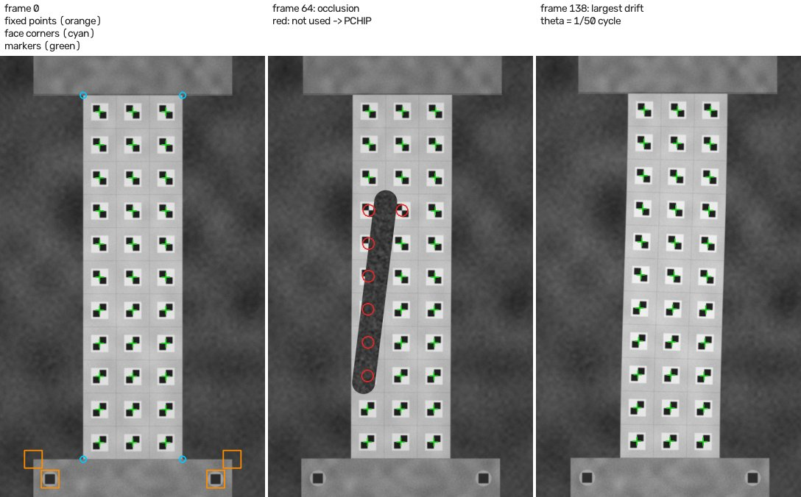
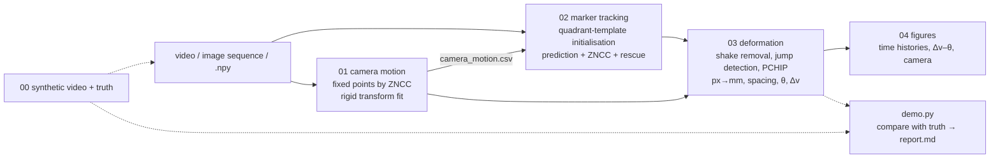
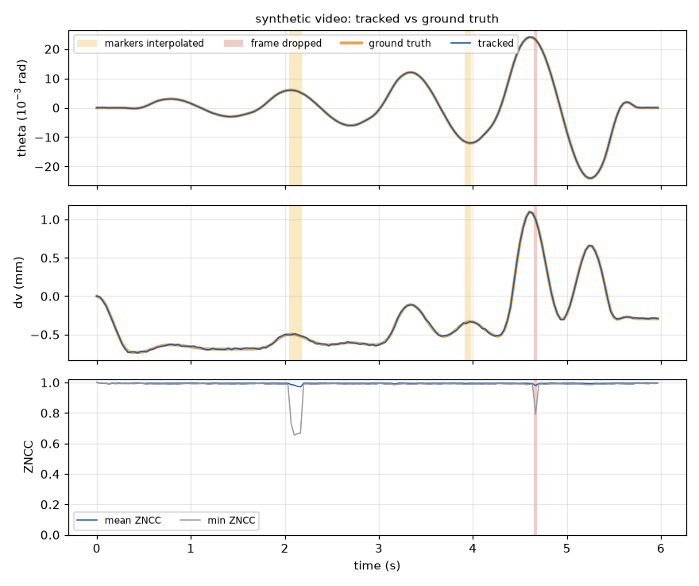
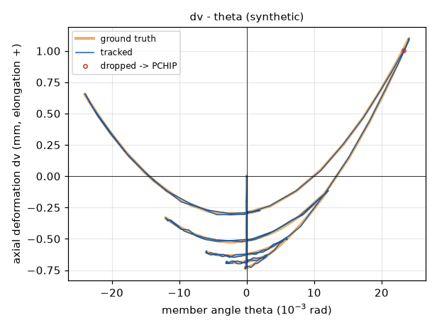
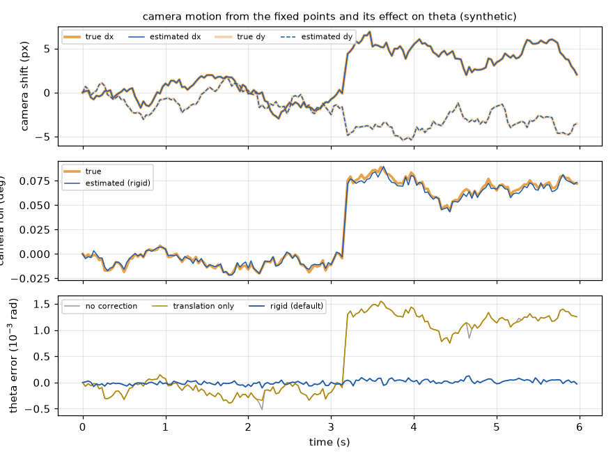

# column-marker-tracking

[](https://github.com/zhouliangtingq2-dev/column-marker-tracking/actions/workflows/demo.yml)

**A pipeline that removes camera shake from RC column test videos using parts that do not move (corners of the stub, bolts), tracks the 3 × 11 markers on the column face, and computes the member angle θ and the axial deformation Δv.**

[日本語 README](README.md)

- **Problem** — 33 checker markers (3 columns × 11 rows) were attached to one face of an RC column (300 × 1100 mm), and the deformation had to be read from a video of about 3200 × 4800 px at 30 fps. Small movements of the tripod (translation and roll) go straight into the "displacements", and people, tools or reflections make the values jump in some frames.
- **Approach** — corners of parts that do not move (the stub) serve as fixed points: the camera motion is estimated for every frame and removed from the marker coordinates. Each marker is tracked by ZNCC template matching (sub-pixel) around a position predicted from the previous frames; weak matches, jumps and unusable frames are removed automatically and filled by PCHIP. Pixels are converted to mm with the known size of the column face, θ comes from a least-squares line through a marker column, and Δv from the distance between the top and bottom marker groups.
- **Outcome** — the original MATLAB implementation was used on the videos of the laboratory's RC column tests (e.g. in the constant-axial-load test, 21 of 853 frames whose values jumped were dropped); the resulting deformations were used in my first-author conference paper (JCI Annual Convention / コンクリート工学年次大会 2026). On a synthetic video with known ground truth (180 frames, with camera shake, occlusion and glare), the RMS error is 4.2 × 10⁻⁵ rad for θ and 0.008 mm for Δv.

This is a Python rewrite of processing that was needed for, and actually used in, the laboratory's RC column loading tests (the original is a laboratory-internal MATLAB implementation). The repository contains **the code and a generator for a synthetic video with ground truth only**. The test videos, images and measured values belong to the laboratory and are not published. Another tool used for the same laboratory's tests: [crack-label-loop](https://github.com/zhouliangtingq2-dev/crack-label-loop) (labelling cracks in RC walls).



*Synthetic demo video (600 × 1000 px): left, frame 0 (orange = fixed points for the camera motion, cyan = column-face corners for px → mm, green = tracked markers) | middle, a frame with occlusion (red = markers not used in this frame, interpolated) | right, the frame with the largest deformation.*

## Workflow



| script | role |
|---|---|
| `scripts/00_make_synthetic.py` | synthetic demo video (PNG sequence), ground-truth CSVs and a ready-to-run config; no experiment data needed |
| `scripts/01_camera_motion.py` | tracks the fixed points (stub corners, bolts ...) with their frame-0 templates and writes the per-frame camera motion (translation / rigid / similarity) to `camera_motion.csv` |
| `scripts/02_track_markers.py` | initialises and tracks the 33 markers; writes coordinates, ZNCC and status (ok / rescued / lost / dropped frame) |
| `scripts/03_deformation.py` | shake removal, jump detection, PCHIP, px → mm, adjacent-marker spacing, θ, Δv |
| `scripts/04_plot.py` | time histories (θ, Δv, ZNCC with dropped frames), Δv–θ, camera motion, displacements of the middle column |
| `scripts/run_pipeline.py` | runs 01–04 in one go |
| `scripts/pick_points.py` | (optional) click the fixed points, the face corners and the corner markers on frame 0 (OpenCV window) and write them to a config; not used by the demo or CI |
| `scripts/demo.py` | runs 00–04, also recomputes with no camera correction / translation only / similarity, compares with the ground truth and writes `report.md` (also run by CI) |
| `cmtrack/` | the processing itself (`camera.py`, `markers.py`, `zncc.py`, `clean.py`, `deform.py`, ...) |
| `tests/` | unit tests for sub-pixel ZNCC, camera-motion estimation, px → mm, jump detection and filling, θ and Δv (`pytest -q`) |

## What happens inside

1. **Input** (`cmtrack/frames.py`): a video file, a folder of images or a `.npy` stack; converted to grayscale and blurred with σ = 1 px (templates are cut from frame 0 after the same blur). `rotate` handles cameras mounted sideways.
2. **Camera motion** (`01`, `camera.py`): a few points on parts that do not move (stub corners, bolts) are given once; their frame-0 templates (41 px by default) are searched by ZNCC in every frame, around a prediction from the previous estimate, with a 3× larger window as a fall-back. A least-squares transform A_k (frame 0 → frame k) is fitted: rigid (rotation + translation) by default, translation if there is only one point, similarity if the camera may move along its axis. A point whose residual exceeds 1 px is left out for that frame.
3. **Marker initialisation** (`02`, `markers.py`): the four corner markers are given roughly and the others are interpolated bilinearly (or all points are given). Around each point an ideal 2 × 2 checker template (per row: upper-right/lower-left black, or upper-left/lower-right black) is matched by ZNCC, which snaps to the black-white junction = the marker centre. A correlation below 0.5 stops the run (this also catches a wrong row pattern).
4. **Tracking**: each marker is predicted in shake-free coordinates as "previous position + 0.7 × velocity" and moved into the current frame with A_k. The search window shrinks when the previous match was good (0.6–1.5 × the default ±12 px). The sub-pixel position is the vertex of a quadratic surface fitted to the 3 × 3 neighbourhood of the ZNCC maximum; the match is accepted if ZNCC ≥ 0.7 and it lies within 10 px of the prediction. Otherwise the frame-0 template is searched in a 3× window (rescue) and accepted only if (1) ZNCC ≥ 0.5, (2) a checker of the right orientation is found at that position, and (3) the vector to the vertical neighbour differs by less than 20 % from frame 0. Otherwise the marker is lost in this frame.
5. **Frame-level checks**: a frame is dropped as a whole when more than 40 % of the markers are lost, the mean ZNCC of the accepted ones is below 0.5, the whole reference (bottom) row is lost, or the overall motion (median step after shake removal) jumps above 5 × the mean of the previous 15 frames and 5 px.
6. **Shake removal and jump detection** (`03`, `clean.py`): tracked coordinates are mapped back into the frame-0 camera with A_k⁻¹. Matches with ZNCC below 0.85 are not used. In the x / y series of every marker, values deviating from the running median (7 frames, corrected for the local slope) by more than max(6 × robust sigma, 1.5 px) are removed as jumps; four or more jumps in one frame drop that frame.
7. **Filling and px → mm**: removed values, lost markers and dropped frames are filled by PCHIP (shape-preserving cubic; the ends hold the nearest value). Coordinates are converted to mm with a least-squares affine map from the four face corners (300 × 1100 mm) by default; separate x / y scales from the corner distances, a homography, or the known marker pitch can be chosen instead.
8. **Deformation** (`deform.py`):
   - changes of the adjacent-marker spacing: X for the 22 horizontal pairs, Y for the 30 vertical pairs
   - member angle θ: least-squares line through the 11 points (Y, X) of the middle column, change of atan(slope) from frame 0 (per column and the mean of the 3 columns are also written)
   - axial deformation Δv: change of the vertical distance between the mean of the top two markers (rows 10, 11) and the bottom two (rows 1, 2) of the middle column (elongation positive, or shortening positive by setting), and ε_v = Δv / initial gauge length
   - the same jump detection (5 frames, floors 0.002 rad and 0.2 mm) runs on θ and Δv; frames that jump are dropped and step 7 is repeated
9. **Outputs and figures** (`04`): `deformation.csv` (θ, Δv, ε_v, dropped flag and reason), `markers_mm.csv`, `markers_filled.csv` (which values were interpolated), `displacement_mm.csv` (also relative to the reference row), `spacing_x_mm.csv`, `spacing_y_mm.csv`, `bad_frames.csv`, and figures (time histories, Δv–θ, camera motion, displacements of the middle column).

## Quick start (everything on the synthetic video)

```bash
python -m venv .venv && source .venv/bin/activate      # Windows: .venv\Scripts\activate
pip install -r requirements.txt
python scripts/demo.py --root demo_runs                 # about 1 min on a CPU (about 20 s of it to make the video)
pytest -q                                               # unit tests (optional)
```

`run_demo.bat` (Windows) and `run_demo.sh` (Linux / macOS) do the same. `demo_runs/report/report.md` contains the comparison with the ground truth and the figures below.

| quantity | RMS error | max error | true range |
|---|---|---|---|
| member angle θ | 4.2 × 10⁻⁵ rad | 1.3 × 10⁻⁴ rad | −0.024 … +0.024 rad |
| axial deformation Δv | 0.008 mm | 0.018 mm | −0.73 … +1.10 mm |
| marker displacement | 0.037 mm | 0.60 mm (an occluded marker) | − |

Effect of the camera-shake correction (same tracking, only the correction changes):

| camera correction | θ RMS error (rad) | Δv RMS error (mm) | displacement RMS error (mm) |
|---|---|---|---|
| none | 8.5 × 10⁻⁴ | 0.012 | 6.1 |
| translation only | 8.5 × 10⁻⁴ | 0.011 | 0.57 |
| **rigid (default)** | **4.2 × 10⁻⁵** | **0.008** | **0.037** |
| similarity | 4.2 × 10⁻⁵ | 0.029 | 0.042 |

Of the injected anomalies, all occlusion (4 frames), glare (2) and tearing (a band of rows shifted, 1) frames were detected (markers interpolated in 6 frames, 1 frame dropped). The frame in which the tripod was bumped (motion-blurred) was absorbed by the shake correction, and no frame without an anomaly was flagged.

(Synthetic video: 600 × 1000 px, 30 fps, 0.75 px/mm (1.33 mm/px), markers 30 px, camera shake up to 7.9 px and 0.09°, seed 0. The ground truth of θ and Δv applies the same definitions (line through the middle column, top two rows minus bottom two rows) to the true marker positions. These numbers check the implementation; they do not state the accuracy on real test videos. They change slightly with the OpenCV version.)



*θ, Δv and ZNCC of the synthetic video (orange = ground truth, blue = tracked). Yellow: frames with some markers interpolated; red: dropped frames.*



*Δv–θ (synthetic). The ground truth is made so that some elongation remains after every cycle.*



*Top: camera translation estimated from the fixed points; middle: roll; bottom: error of θ. Correcting the translation alone does not reduce the θ error — the camera roll goes straight into θ.*

## Using your own video

```bash
# 1. copy configs/example.yaml; set the video path, face size, marker rows / patterns and template sizes
# 2. give the points on frame 0 (or type the coordinates into the YAML)
python scripts/pick_points.py --frames path/to/video.mp4 --what fixed   --out picked.yaml   # fixed points (a few, spread out)
python scripts/pick_points.py --frames path/to/video.mp4 --what corners --out picked.yaml   # face corners LB, LT, RB, RT
python scripts/pick_points.py --frames path/to/video.mp4 --what markers --out picked.yaml   # the four corner markers
# 3. run 01 -> 04
python scripts/run_pipeline.py --config my_test.yaml --config picked.yaml --out runs/test1
# intermediate results are CSV files, so the deformation can be recomputed with other thresholds
python scripts/03_deformation.py --config my_test.yaml --config picked.yaml --out runs/test1
python scripts/04_plot.py        --config my_test.yaml --config picked.yaml --out runs/test1
```

All settings and defaults are in `configs/example.yaml` and `cmtrack/config.py`. `--config` can be repeated; later files override earlier ones. Tested with Python 3.11 / 3.13, NumPy 2.x, OpenCV 5.0 (`requirements.txt`).

## Design decisions (and why)

- **Correct the coordinates, not the images** — the original workflow wrote a stabilised video first and tracked on it. Here the camera transform A_k is estimated first, markers are tracked in the original frames and their coordinates are mapped back with A_k⁻¹. Nothing is resampled (no extra blur), and no video has to be written. A_k is also used to predict the search windows, so a tripod bump of several pixels does not lose the markers (the "camera bump" frame of the demo).
- **Fixed-point templates are never updated** — they are the reference for the shake itself, so the frame-0 templates are used to the end (updating them lets them drift). Marker templates are not updated by default either: in the synthetic demo, updating made almost no difference, so the drift-free option is the default (`ema`, a slow update only when ZNCC ≥ 0.9, is kept for videos whose surface slowly changes).
- **Rigid camera model by default** — with translation only, a small roll (up to 0.09° in the demo) goes straight into θ (θ RMS error 8.5 × 10⁻⁴ rad → 4.2 × 10⁻⁵ rad with the rigid model). The similarity model also estimates the scale; with fixed points lying side by side on the stub the baseline is short, the scale estimate wobbles, and multiplied by the gauge length it raised the Δv error from 0.008 mm to 0.029 mm. Choose similarity only if the camera may move along its axis.
- **Sub-pixel position from a 3 × 3 quadratic surface with an xy term** — separate parabolas in x and y are fine for checkers, whose correlation peak is symmetric about the axes, but they are biased when the peak is elongated obliquely, as for the texture around fixed points. In a speckle-pattern test (`tests/test_matching.py`), a shift of 0.5 px in x alone moved the y estimate by up to 0.19 px; with the vertex of the full quadratic surface the error stayed below 0.01 px.
- **Two quadrant templates for initialisation** — the marker centre is the black-white junction, so an ideal checker template lands exactly on it; clicks may be a few pixels off, and a wrong row pattern gives a negative correlation and is noticed at once. Rescued matches are also checked for a checker of the right orientation, which prevents jumping to a neighbouring marker or a half-hidden pattern.
- **Separate "tracking" from "using"** — tracking (02) keeps every position and correlation it found; whether a value is used (ZNCC below 0.85, jumps, dropped frames) is decided in 03. Changing a threshold only means re-running 03, and `bad_frames.csv` keeps the reasons. Partly hidden markers can be off by 0.3–0.5 px while their correlation is still fairly high (occlusion frames of the demo), so the threshold for using a value (0.85) is stricter than the one for keeping the track (0.7).
- **Jumps relative to a running median** — markers move smoothly during loading, so a value that is off for one or two frames departs from the running median. A plain running median was dragged by an outlier inside the window during fast motion and flagged the neighbouring frames too, so the slope inside the window (median of the differences) is compensated before the median is taken.
- **θ from a fitted line, Δv as a vertical component** — a fit through 11 points is less sensitive to one bad point than a line through two. Marker rows are not assumed to be evenly spaced; the actual positions are used as heights. Δv is the change of the vertical distance between the gauge points (the same idea as a vertical displacement transducer), averaged over two rows at the top and two at the bottom.

## Use in the experiments

In the laboratory's RC column loading tests, 33 markers (3 columns × 11 rows; rows 1–5 and rows 6–11 have opposite black-white orientations) were attached to one face of the column (300 × 1100 mm), and the videos (about 3200 × 4800 px, 30 fps) were processed with this workflow. Frames whose values jumped were detected automatically and dropped or filled (e.g. 21 of 853 frames in the constant-axial-load test), and the resulting deformations (member angle θ and axial deformation Δv) were used in my first-author conference paper (JCI Annual Convention / コンクリート工学年次大会 2026). The processing for the experiments was done with the laboratory-internal original implementation (MATLAB); this repository is its Python rewrite. Videos, images and measured values are not published.

## Limitations and next steps

- The column face is assumed to be roughly parallel to the image plane, with markers moving within that face. Out-of-plane motion is not handled (a homography from the corners can be chosen, but out-of-plane motion cannot be corrected).
- With fixed points only side by side on the stub, the roll estimate is limited by the horizontal baseline; most of the θ error in the synthetic demo is this roll estimation error (RMS about 4 × 10⁻⁵ rad). Fixed points far apart vertically would improve it.
- Jump detection assumes that markers move smoothly. For heavily subsampled videos or sudden reversals, the running-median window and thresholds need to be revisited.
- Long occlusions (someone walking in front of the camera) cannot be interpolated; such intervals are excluded with `cleaning.drop_ranges_s`.
- Markers whose appearance changes a lot (peeling off, dirt) cannot be tracked (the `ema` update follows gradual changes to some extent).
- The synthetic demo numbers check the implementation; they do not guarantee the accuracy on real videos.

## Development note

The problem setting, the workflow design and the checks on the laboratory's test videos are my own. The first drafts of the code were written by generative AI (ChatGPT / Claude); specifying the behaviour, testing, fixing defects and tuning the thresholds were done by me. The original processing is a laboratory-internal MATLAB implementation; this repository is its Python rewrite, with validation on a synthetic video with ground truth, unit tests and CI added (the laboratory's existing scripts and their code are not included).

## License

MIT License (code). Dependencies: NumPy, OpenCV, SciPy, Matplotlib, PyYAML.

---
ZHOU Liangting — Graduate School of Engineering, Tohoku University (2nd-year master's student)
